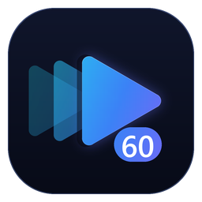

# Cine60

**Player de vídeo e música sobre o motor do VLC, com movimento suave a 60 fps.**

[Baixar](https://github.com/adrianobbarcelos/Cine60/releases/latest) · [Relatar um problema](https://github.com/adrianobbarcelos/Cine60/issues/new/choose) · [Histórico](CHANGELOG.md) · [English](README.md)

O Cine60 é um fork do [Refrata](https://github.com/LucsLabsStudios/refrata), de LucsLabs Studios, sob a
mesma licença GPL-3.0. A maior parte do programa vem dele.

## O que o Cine60 acrescenta

- **Painel Picture** no player (`G`): movimento suave, realces de detalhes e de luz, predefinições.
  `V` liga e desliga o movimento suave; `Shift+V` troca a predefinição.
- **Movimento suave** com o horário real de cada quadro e detecção de cortes também em cenas escuras.
- **Primeira abertura mais rápida**, com o cache de plugins do VLC válido em qualquer fuso horário.
- **Controles que somem** com o mouse parado.

## O que vem do Refrata

Formatos e protocolos do VLC, biblioteca, legendas (inclusive por IA), equalizador, picture-in-picture,
transmissão para TV e 14 idiomas.

## Problemas conhecidos

- Em câmera muito rápida, partes da imagem podem sair rasgadas com o movimento suave ligado.
- A saída HDR real vem desligada: com o HDR do Windows, ela escurecia vídeos SDR. Vídeos HDR são
  convertidos para SDR.
- O instalador não tem assinatura digital do Windows: o SmartScreen pode avisar "editor desconhecido".
- A versão Linux não é publicada; só os testes rodam no Linux.

## Instalar

Windows 10 ou 11 de 64 bits: [baixe](https://github.com/adrianobbarcelos/Cine60/releases/latest) o `Cine60-Setup-<versão>.exe`, que não pede
administrador, ou o `Cine60-<versão>-portable.zip`, que não precisa instalar. As atualizações só são
aceitas com a assinatura Ed25519 do Cine60.

## Compilar

O [workflow de build](.github/workflows/build.yml) é a receita usada nos lançamentos. Detalhes em
[docs/development.md](docs/development.md) (herdado do Refrata).

## Licença

[GPL-3.0](LICENSE). Refrata © LucsLabs Studios. Inclui o libVLC (VideoLAN, LGPL 2.1+) e o Qt for Python
(LGPL 3). VLC é marca da VideoLAN; o Cine60 é independente dela e da LucsLabs Studios.
